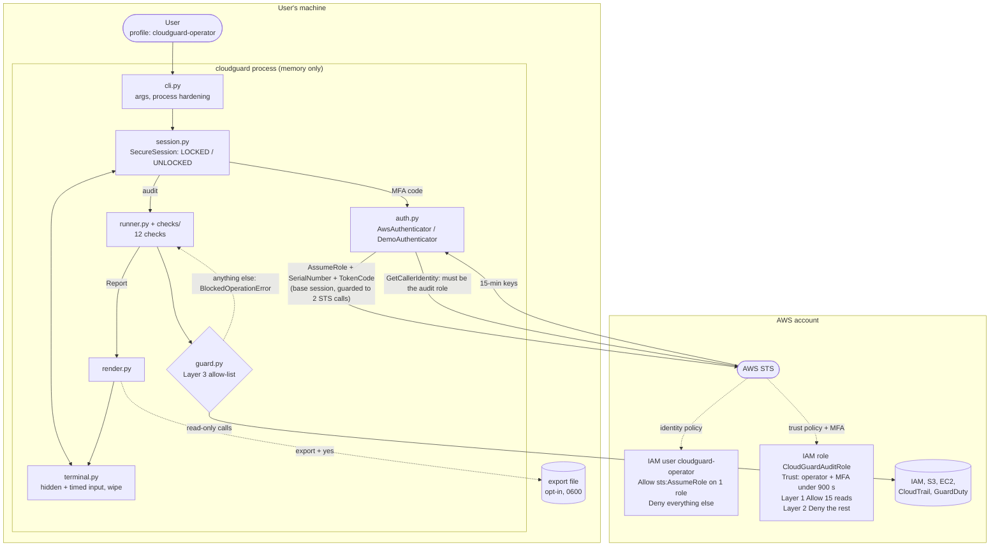
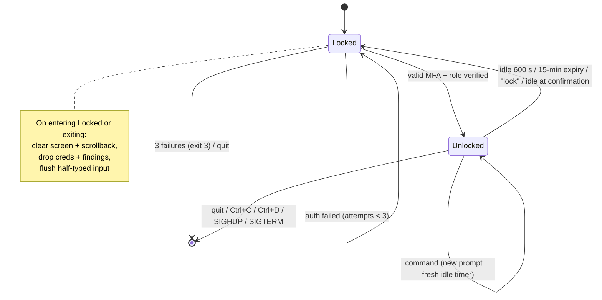
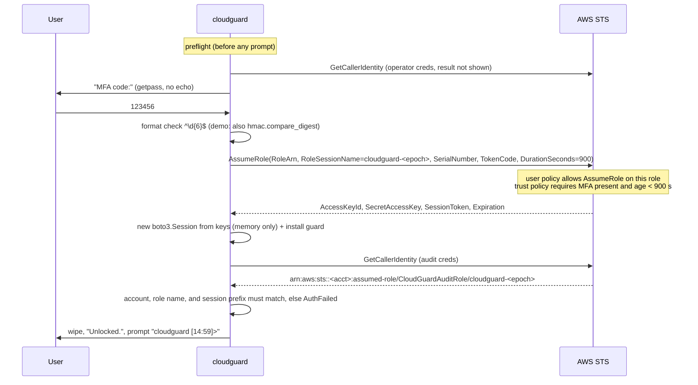

# Design Document: cloudguard

## Overview

`cloudguard` is a Python 3.11+ interactive CLI that audits an AWS account for 12 common misconfigurations. It runs as a self-locking, in-memory session:

1. The user starts it as the **Operator User**. That identity can do exactly one thing: ask STS for the Audit Role.
2. The user types an MFA code into a hidden prompt.
3. STS returns 15-minute credentials for the read-only **Audit Role**.
4. Checks run through a client-side guard and the results are shown in the terminal.
5. The session locks after 10 minutes idle or at the 15-minute expiry. Locking wipes the screen and scrollback and drops the credentials and results.

Read-only access is enforced in three layers. Any one layer is enough on its own:

| Layer | Where | Mechanism |
|---|---|---|
| 1. Allow-list policy | AWS IAM (Audit Role) | grants only 15 specific read actions, with no wildcards |
| 2. Explicit deny | AWS IAM (Audit Role) | `Deny` + `NotAction` on everything outside the allow-list, so a later broad `Allow` can't widen it |
| 3. Client guard | botocore | `before-call` hook rejects any operation not on the allow-list before it's signed or sent |

The Operator User is separately limited to one action (`sts:AssumeRole` on the Audit Role) plus an explicit deny on everything else (Requirement 14).

Tech stack (pinned): `boto3==1.43.110`, `rich==15.0.0`, `moto[ec2,iam,s3]==5.2.3` (demo and tests), `pytest==9.1.1`. There's no web server and no listening port. Nothing is persisted unless the user explicitly runs `export`.

## Architecture



### Session state machine



### Authentication sequence



## Components and Interfaces

Project layout:

```
cloudguard/
├── pyproject.toml                  # pinned deps, `cloudguard` entry point
├── dev.sh                          # sandboxed setup / test / demo / run / clean
├── README.md
├── iam-policy.json                 # Audit Role allow-list + deny (Req 8.8)
├── iam-trust-policy.json           # Audit Role trust policy (MFA)
├── iam-operator-policy.json        # Operator User policy (Req 14.6)
├── infra/
│   ├── cloudguard-role.yaml        # CloudFormation: Audit Role (Req 8.1–8.5)
│   └── cloudguard-operator.yaml    # CloudFormation: Operator User (Req 14.1–14.5)
├── src/cloudguard/
│   ├── __init__.py  __main__.py
│   ├── cli.py                      # argparse, process hardening, exit codes
│   ├── guard.py                    # allow-lists, iam_actions(), botocore hook
│   ├── auth.py                     # AwsAuthenticator, DemoAuthenticator
│   ├── terminal.py                 # Terminal: hidden input, timed input, wipe
│   ├── session.py                  # SecureSession state machine + commands
│   ├── models.py                   # Severity, Status, Finding, Report
│   ├── runner.py                   # runs ALL_CHECKS, isolates failures
│   ├── render.py                   # rich table, detail panels, markdown, json
│   ├── export.py                   # write_private(): 0600, O_EXCL, O_NOFOLLOW
│   ├── demo.py                     # moto environment + seeded misconfigs
│   └── checks/
│       ├── __init__.py             # ALL_CHECKS registry
│       ├── base.py                 # AuditContext, CheckInfo, error_code()
│       └── iam.py  s3.py  network.py  logging_checks.py   # not logging.py: avoids stdlib clash
└── tests/
    ├── conftest.py                 # moto fixtures, FakeClock, FakeTerminal
    └── test_checks.py  test_guard.py  test_session.py  test_auth_and_export.py
```

Every source file follows the teaching-style comment convention defined in `tasks.md`:
- a file header (what it is, why it exists, which requirements it covers)
- numbered `SECTION` banners
- `# SECURITY:` tags on every security-motivated line

### `guard.py`: client-side read-only enforcement (Req 8.6, 1.6)

```python
# Keyed by botocore service name -> API operation names (not IAM action names).
AUDIT_OPERATIONS = {
    "sts":        {"GetCallerIdentity"},
    "iam":        {"GenerateCredentialReport", "GetCredentialReport",
                   "GetAccountSummary", "GetAccountPasswordPolicy"},
    "s3":         {"ListBuckets", "GetPublicAccessBlock", "GetBucketPolicyStatus",
                   "GetBucketPolicy"},
    "s3control":  {"GetPublicAccessBlock"},
    "ec2":        {"DescribeSecurityGroups"},
    "cloudtrail": {"DescribeTrails", "GetTrailStatus"},
    "guardduty":  {"ListDetectors", "GetDetector"},
}
BASE_OPERATIONS = {"sts": {"AssumeRole", "GetCallerIdentity"}}

def iam_actions(operations) -> set[str]       # maps API ops to IAM action names
class BlockedOperationError(Exception): ...
def install_guard(session: boto3.Session, allowed: dict[str, set[str]]) -> None
    # registers a "before-call" hook on session.events, unique_id="cloudguard-guard"
```

- The guard is installed on both boto3 sessions before any client is created, so every client inherits it.
  - The base (operator) session gets `BASE_OPERATIONS`.
  - The audit session gets `AUDIT_OPERATIONS`.
- It denies by default: any `(service, operation)` not on the list raises `BlockedOperationError` before the request is signed or sent.
- `iam_actions()` handles the three names that differ between the API and IAM:
  - `s3.ListBuckets` → `s3:ListAllMyBuckets`
  - `s3.GetPublicAccessBlock` → `s3:GetBucketPublicAccessBlock`
  - `s3control.GetPublicAccessBlock` → `s3:GetAccountPublicAccessBlock`
- `guard.py` is the single source of truth. Tests assert that `iam-policy.json` and both lists in the CloudFormation template equal `iam_actions(AUDIT_OPERATIONS)`.

### `auth.py` (Req 1.1–1.6, 8.7, 9.3, 11.1–11.4)

```python
SESSION_SECONDS = 900
MFA_CODE_PATTERN = re.compile(r"^\d{6}$")
SESSION_NAME_PREFIX = "cloudguard-"

@dataclass(frozen=True)
class AuthConfig:   role_arn: str; mfa_serial: str; region: str; profile: str | None
@dataclass
class AuditSession: boto_session: boto3.Session; account_id: str; expires_at: datetime

class AuthConfigError(Exception)   # setup problem -> exit 2
class AuthFailed(Exception)        # always the message "Authentication failed"

class AwsAuthenticator:
    def preflight(self) -> None                       # base session + BASE guard + GetCallerIdentity
    def authenticate(self, mfa_code) -> AuditSession
    def _verify_code(self, mfa_code) -> None          # format check; demo adds more
    def _is_audit_role(self, identity_arn) -> bool

class DemoAuthenticator(AwsAuthenticator):
    demo_code: str                                    # secrets.randbelow, 6 digits, new each run
    def _verify_code(self, mfa_code) -> None          # + hmac.compare_digest
```

- `preflight()` raises `AuthConfigError` in three cases:
  - the profile doesn't exist (`ProfileNotFound`)
  - there are no credentials
  - `GetCallerIdentity` fails
- `authenticate()` follows the authentication sequence diagram. Any `ClientError`, `BotoCoreError`, format failure, or identity mismatch raises `AuthFailed`, so the cause is never disclosed (Req 11.4).
- `_is_audit_role()` requires `arn:aws:sts::<role account>:assumed-role/<role name>/cloudguard-*`. That rejects a wrong account, a wrong role, an IAM user, and a foreign session name.
- Demo mode runs the same flow against moto. moto doesn't validate MFA codes, so `DemoAuthenticator` checks the code itself.

### `terminal.py` (Req 11.1, 12.2, 13.1)

```python
CLEAR_ALL = "\033[3J\033[H\033[2J"   # scrollback + cursor home + screen
STDIN_FD = 0

class Terminal:
    def print(self, *args, **kwargs) -> None                  # rich Console, record=False
    def wipe(self) -> None                                    # writes CLEAR_ALL; ignores closed tty
    def read_hidden(self, prompt) -> str                      # getpass, no echo
    def read_line(self, prompt, timeout) -> str | None        # None on timeout, EOFError on Ctrl+D
    def flush_input(self) -> None                             # drops pending bytes + tcflush
```

- `readline` is never imported. That means no line-editing history and no `~/.python_history` (Req 13.1).
- `read_line` reads raw bytes from fd 0 with `select()` + `os.read()` and keeps its own `_pending` buffer.
  - It doesn't use `sys.stdin.readline()`, because Python's internal stdin buffer hides a second pasted line from `select()`. The prompt then hung until the timeout; the pseudo-terminal smoke test found this.
  - The timeout is a monotonic deadline across partial reads.
- `flush_input()` runs on every lock, so text typed before a lock can't be read as input after it.
- The module is POSIX-only (`select`, `termios`), which fits the macOS and Linux target.
- `SecureSession` receives the `Terminal` as a dependency, so tests swap in `FakeTerminal` with scripted input and a `FakeClock`.

### `session.py`: `SecureSession` (Req 7.1–7.3, 11.5, 11.6, 12.1–12.5, 13.1–13.3)

```python
IDLE_TIMEOUT_SECONDS = 600   # Req 12.1
MAX_AUTH_ATTEMPTS = 3        # Req 11.5
EXIT_OK, EXIT_AUTH_FAILED = 0, 3

class SecureSession:
    def __init__(self, authenticator, terminal, region, demo=False, clock=time.monotonic)
    locked: bool                                  # property: audit_session is None
    def run(self) -> int                          # loop auth -> commands; finally: forget + wipe
    def lock(self, reason) -> None                # forget secrets, flush input, wipe, print reason
    def _authenticate_loop(self) -> str           # "unlocked" | "quit" | "failed"
    def _command_loop(self) -> str                # "locked" | "quit"
    def _confirm(self, prompt) -> str | None      # yes/no that also honors idle + expiry

def disable_core_dumps() -> None                  # RLIMIT_CORE = (0, 0)
def secure_umask() -> None                        # umask 0o077
```

Deadline handling:
- On unlock, `deadline = clock() + min(seconds until STS Expiration, 900)`.
- Each prompt waits `min(IDLE_TIMEOUT_SECONDS, deadline - clock())`. Every command shows a new prompt, so any input resets the idle timer.
- The deadline is checked again after input arrives, so a command typed after expiry never runs.
- The prompt shows the time left: `[DEMO] cloudguard [mm:ss]> ` (Req 12.4).
- While locked, the only prompt is the hidden `MFA code:` prompt. Typed commands are treated as wrong codes (Req 11.6).

Commands:

| Command | Action |
|---|---|
| `audit` | run all checks, store `Report` in memory, print summary table |
| `show <CRITICAL\|HIGH\|MEDIUM\|LOW\|check-id>` | detailed findings incl. remediation |
| `export <markdown\|json> <path>` | warn → `_confirm` "yes" → `write_private`; if the file exists, confirm again → overwrite (Req 7.3) |
| `lock` | lock now |
| `help` | list commands |
| `quit` / `exit` | return `EXIT_OK` (the wipe happens in `run()`'s `finally`) |

Exit and wipe paths. All of them go through `run()`'s `finally`, which calls `_forget_secrets()` + `wipe()`:
- `KeyboardInterrupt` and `EOFError` are caught in `run()` and return `EXIT_OK`.
- The `SIGHUP` and `SIGTERM` handlers (installed in `cli.py`) raise `SystemExit(0)`, which unwinds through the same `finally`.
- `atexit.register(terminal.wipe)` is a final safety net.

`_forget_secrets()` sets `audit_session` and `report` to `None`, resets the deadline, and calls `gc.collect()`. Python can't securely zero memory, so this is the best available measure. The threat model records the limitation.

### `cli.py` (Req 1.2–1.5, 13.4, 13.5)

- **Flags:** `--demo`, `--profile`, `--region`, `--role-arn`, `--mfa-serial`, `--version`. None of them accepts a secret.
- **Fallbacks:**
  - role and MFA serial: `CLOUDGUARD_ROLE_ARN` / `CLOUDGUARD_MFA_SERIAL`
  - region: `--region` → profile region → `us-east-1`
- **`harden_process()`** runs before anything sensitive:
  - core dumps off and `umask 077`
  - `boto3`, `botocore`, `urllib3`, and `s3transfer` loggers set to `CRITICAL`
  - SIGHUP and SIGTERM handlers
  - the `atexit` wipe
- **Refuses non-TTY stdin** with exit 2. Hidden input and timeouts need a real terminal.
- Any unexpected exception → wipe, a generic message, exit 1. No traceback is printed.
- In demo mode, `mock.stop()` runs in a `finally` block.

### `models.py` (Req 6.1, 6.2, 7.4)

```python
class Severity(IntEnum): LOW=1; MEDIUM=2; HIGH=3; CRITICAL=4
class Status(str, Enum): PASS="PASS"; FAIL="FAIL"; ERROR="ERROR"

@dataclass(frozen=True)
class Finding:
    check_id: str; title: str; status: Status; severity: Severity
    resource: str; cis: str; remediation: str; detail: str = ""

@dataclass
class Report:
    account_id: str; region: str; generated_at: datetime; demo: bool
    findings: list[Finding]
    def counts(self) -> dict[str, dict[str, int]]   # by status, by severity
```

### Checks (`checks/`) and `runner.py` (Req 2–6)

```python
@dataclass
class AuditContext:
    session: boto3.Session; region: str; account_id: str; cache: dict
    def client(self, service, region=None)

@dataclass(frozen=True)
class CheckInfo:
    check_id: str; title: str; severity: Severity; cis: str; remediation: str
    def passed(resource, detail="") / failed(...) / error(...) -> Finding

CheckFn = Callable[[AuditContext], list[Finding]]
ALL_CHECKS: list[tuple[CheckInfo, CheckFn]]      # iam + s3 + network + logging_checks

def run_audit(ctx: AuditContext, demo=False) -> Report
```

How checks report results:
- Each check returns one `FAIL` finding per bad resource. If nothing is bad, it returns a single `PASS` that says how many resources it checked (Req 6.2).
- `ctx.cache` shares expensive lookups across checks: the account summary, credential report, bucket list, and security groups.
- `run_audit` wraps each check (Req 6.3):
  - `BlockedOperationError` becomes an `ERROR` finding with resource `guard`.
  - Any other exception becomes an `ERROR` finding showing only the error code or type, never a traceback.

| ID | Check | Severity | CIS v3.0.0 | API calls |
|---|---|---|---|---|
| IAM-01 | Root MFA enabled | CRITICAL | 1.5 | `GetAccountSummary` (`AccountMFAEnabled`) |
| IAM-02 | No root access keys | CRITICAL | 1.4 | `GetAccountSummary` (`AccountAccessKeysPresent`) |
| IAM-03 | Console users have MFA | HIGH | 1.10 | credential report (`password_enabled`, `mfa_active`) |
| IAM-04 | Access keys ≤ 90 days | MEDIUM | 1.14 | credential report (`access_key_N_active`, `_last_rotated`) |
| IAM-05 | Password policy ≥ 14 chars | MEDIUM | 1.8 | `GetAccountPasswordPolicy` (`NoSuchEntity` → FAIL) |
| S3-01 | Account Block Public Access | HIGH | 2.1.4 | `s3control.GetPublicAccessBlock` |
| S3-02 | Bucket Block Public Access | HIGH | 2.1.4 | `s3.GetPublicAccessBlock` per bucket |
| S3-03 | Bucket not public | CRITICAL | 2.1.4 | `s3.GetBucketPolicyStatus`. If it returns no `IsPublic`, fall back to `GetBucketPolicy` and flag an unconditioned `Allow` to `Principal: "*"` (no policy → PASS) |
| NET-01 | No SSH from internet | HIGH | 5.2 / 5.3 | `DescribeSecurityGroups` |
| NET-02 | No RDP from internet | HIGH | 5.2 / 5.3 | `DescribeSecurityGroups` |
| LOG-01 | Multi-region trail logging | HIGH | 3.1 | `DescribeTrails` + `GetTrailStatus` |
| LOG-02 | GuardDuty enabled | MEDIUM | — (AWS FSBP GuardDuty.1) | `ListDetectors` + `GetDetector` |

- **Credential report:** call `GenerateCredentialReport` until it reports `COMPLETE` (at most 10 tries, 1 second apart), then `GetCredentialReport` and parse with `csv.DictReader`. The `<root_account>` row is skipped, since root is covered by IAM-01 and IAM-02. The report is fetched once per audit and shared by IAM-03 and IAM-04.
- **Port matching (Req 4.3):** a rule matches when the protocol covers the port and the source is the whole internet.
  - The protocol covers the port if it's `-1` (all traffic), or if it's `tcp` / `6` with `FromPort <= port <= ToPort`.
  - The source is the whole internet if any IPv4 range is `0.0.0.0/0` or any IPv6 range is `::/0`.
- **CloudTrail:** `GetTrailStatus` is called in each multi-region trail's `HomeRegion`.

### `render.py` / `export.py` (Req 7.1–7.5, 9.4)

- `summary_table(report)` draws a rich table, worst first.
  - Colors: FAIL in red, ERROR in yellow, PASS in green.
  - The caption comes from `header_text()`: account, region, UTC time, and counts.
  - The title gets `[DEMO DATA]` in demo mode.
- `select_findings(report, selector)` matches a severity name or a check ID. `detail_view(finding)` renders a panel that includes the fix.
- `to_markdown(report)` and `to_json(report)` are pure functions. The Markdown version escapes `|` in table cells and adds a DEMO DATA note in demo mode.
- `write_private(path, content, overwrite=False) -> str`:
  - opens with `O_WRONLY|O_CREAT|O_NOFOLLOW`, plus `O_EXCL` or (when overwriting) `O_TRUNC`, mode `0o600`
  - calls `fchmod(0o600)` so an overwritten file is tightened too
  - raises `FileExistsError` so the session can ask before overwriting, and refuses symlinks

### `demo.py` (Req 9.1–9.4)

`start_demo() -> (mock, AuthConfig)`:
1. Sets fake `AWS_*` credentials, points `AWS_CONFIG_FILE` and `AWS_SHARED_CREDENTIALS_FILE` at `/dev/null`, and unsets `AWS_PROFILE`. The user's real `~/.aws` is unreachable, and even a request that escaped the mock would be rejected by AWS.
2. Starts `moto.mock_aws()`.
3. Creates `CloudGuardAuditRole` with the real `iam-policy.json`. If the file is missing, it builds the same policy from `guard.py`.
4. Seeds these resources:

| Resource | Expected result |
|---|---|
| root without MFA | IAM-01 FAIL |
| `demo-alice` (console password, no MFA) | IAM-03 FAIL |
| `demo-bob` (new access key) | IAM-04 PASS |
| no password policy | IAM-05 FAIL |
| no account BPA | S3-01 FAIL |
| `demo-public-website` (public policy, no BPA) | S3-02, S3-03 FAIL |
| `demo-private-logs`, `demo-trail-logs` (BPA on) | S3-02 PASS for them |
| `demo-ssh-open` (22 from 0.0.0.0/0) | NET-01 FAIL |
| `demo-web` (443 only) | NET-02 PASS |
| single-region logging trail | LOG-01 FAIL |
| enabled GuardDuty detector | LOG-02 PASS |

## Data Models

All models live in memory only. The one exception is a `Report`, which is written to disk when the user runs `export`.

| Model | File | Fields | Notes |
|---|---|---|---|
| `Severity` | `models.py` | `LOW=1`, `MEDIUM=2`, `HIGH=3`, `CRITICAL=4` | `IntEnum`, so findings sort worst-first |
| `Status` | `models.py` | `PASS`, `FAIL`, `ERROR` | `ERROR` = couldn't evaluate (denied, blocked, bug) |
| `Finding` | `models.py` | `check_id`, `title`, `status`, `severity`, `resource`, `cis`, `remediation`, `detail` | frozen dataclass; `to_dict()` for JSON |
| `Report` | `models.py` | `account_id`, `region`, `generated_at`, `demo`, `findings` | `counts()` by status and by FAIL severity; `sorted_findings()` |
| `CheckInfo` | `checks/base.py` | `check_id`, `title`, `severity`, `cis`, `remediation` | builds findings via `passed()` / `failed()` / `error()` |
| `AuditContext` | `checks/base.py` | `session` (guarded), `region`, `account_id`, `cache` | the cache shares the credential report, buckets, and security groups between checks |
| `AuthConfig` | `auth.py` | `role_arn`, `mfa_serial`, `region`, `profile` | identifiers only, no secrets |
| `AuditSession` | `auth.py` | `boto_session`, `account_id`, `expires_at` | holds the temporary keys; set to `None` on lock |

## IAM Design (`infra/cloudguard-role.yaml`)

Mapping from API operations to IAM actions:
- `ListBuckets` → `s3:ListAllMyBuckets`
- `s3.GetPublicAccessBlock` → `s3:GetBucketPublicAccessBlock`
- `s3control.GetPublicAccessBlock` → `s3:GetAccountPublicAccessBlock`

```yaml
AWSTemplateFormatVersion: "2010-09-09"
Description: cloudguard read-only audit role (free; IAM has no charge)
Parameters:
  TrustedPrincipalArn:   # IAM user/role allowed to assume, same account
    Type: String
Resources:
  CloudGuardAuditRole:
    Type: AWS::IAM::Role
    Properties:
      RoleName: CloudGuardAuditRole
      MaxSessionDuration: 3600
      AssumeRolePolicyDocument:
        Version: "2012-10-17"
        Statement:
          - Effect: Allow
            Principal: { AWS: !Ref TrustedPrincipalArn }
            Action: sts:AssumeRole
            Condition:
              Bool:            { aws:MultiFactorAuthPresent: "true" }
              NumericLessThan: { aws:MultiFactorAuthAge: "900" }
      Policies:
        - PolicyName: CloudGuardReadOnlyAllowList
          PolicyDocument:
            Version: "2012-10-17"
            Statement:
              - Sid: AllowAuditReads
                Effect: Allow
                Action: [ <15 actions below> ]
                Resource: "*"
              - Sid: DenyEverythingElse
                Effect: Deny
                NotAction: [ <same 15 actions> ]
                Resource: "*"
```

The 15 allowed actions:
- `sts:GetCallerIdentity`
- `iam:GenerateCredentialReport`, `iam:GetCredentialReport`, `iam:GetAccountSummary`, `iam:GetAccountPasswordPolicy`
- `s3:ListAllMyBuckets`, `s3:GetBucketPublicAccessBlock`, `s3:GetBucketPolicyStatus`, `s3:GetBucketPolicy`, `s3:GetAccountPublicAccessBlock`
- `ec2:DescribeSecurityGroups`
- `cloudtrail:DescribeTrails`, `cloudtrail:GetTrailStatus`
- `guardduty:ListDetectors`, `guardduty:GetDetector`

Notes:
- `Resource: "*"` is required here. These list/describe/account-level actions don't support resource-level permissions, and the explicit deny limits the blast radius.
- `iam:GenerateCredentialReport` is classified by AWS as a Read-level action. It only refreshes the account's credential report, and it changes no resources.
- The trusted principal must be a specific ARN, not `:root` of the account. The principal's own policy needs only `sts:AssumeRole` on this role.

## Operator Identity (`infra/cloudguard-operator.yaml`)

The person running cloudguard uses a dedicated IAM user, `cloudguard-operator`. Its credentials are the Base Credentials.

| Identity | Allow | Deny | Console | MFA enforced by |
|---|---|---|---|---|
| `cloudguard-operator` user | `sts:AssumeRole` on `arn:aws:iam::${AWS::AccountId}:role/CloudGuardAuditRole` | `NotAction: sts:AssumeRole` | none (no `LoginProfile`) | the role's trust policy |
| `CloudGuardAuditRole` role | 15 read actions | `NotAction` on those 15 | n/a | trust policy: `MultiFactorAuthPresent` + `MultiFactorAuthAge < 900` |

Design notes:
- **No MFA condition on the user policy.** The operator signs `AssumeRole` with a long-term access key, and AWS only adds `aws:MultiFactorAuthPresent` to requests made with short-term credentials. Putting the condition there would deny every login. The AWS-documented pattern is: the user policy allows `AssumeRole`, and the role's trust policy requires MFA.
- **No circular dependency.** The operator template builds the role ARN from the role's name with `!Sub`, so it can be deployed first. The role template then takes the operator ARN as `TrustedPrincipalArn`. AWS rejects trust policies that name a principal that doesn't exist yet, which is why the order matters.
- **`sts:GetCallerIdentity` still works** under the explicit deny. AWS always permits it, so the preflight check in `auth.py` runs.
- **Teardown order** is the reverse: delete the role stack, remove the access key and MFA device, then delete the operator stack.

## Data Flow and Persistence

| Data | Lives in | Written to disk? |
|---|---|---|
| Base credentials | user's existing `~/.aws` / SSO (unchanged) | not by cloudguard |
| MFA code | local variable, discarded after `AssumeRole` | never |
| Audit role credentials | `AuditSession.boto_session` (memory) | never; no botocore cache configured |
| Typed commands | local variable per loop iteration | never (no readline) |
| Findings | `SecureSession.report` (memory) | only on explicit `export`, 0600 |
| Logs | none (SDK loggers set to CRITICAL; no file handlers) | never |
| Core dumps | disabled (`RLIMIT_CORE = 0`) | never |
| Operator access key | `~/.aws/credentials` profile `cloudguard-operator`, written by the user via `aws configure set` (README step 4) | by the AWS CLI, not by cloudguard |

## Error Handling

| Situation | Behavior | Exit code |
|---|---|---|
| No base credentials / missing role ARN or MFA serial | clear message, no traceback | 2 |
| Wrong or malformed MFA code / AssumeRole denied / role ARN mismatch | "Authentication failed", retry | — |
| 3 failed auth attempts | wipe, message | 3 |
| Check throws (incl. `AccessDenied`, `BlockedOperationError`) | ERROR finding, continue | — |
| Unexpected exception in session loop | wipe, generic message, no traceback | 1 |
| Normal quit / signal | wipe | 0 |

## Correctness Properties

These invariants must always hold. Each one is enforced by a test.

### Property 1: No writes
For any operation not in `AUDIT_OPERATIONS`, the guarded audit session raises `BlockedOperationError` before the request is sent, and the target resource is unchanged.
**Validates: Requirements 8.6, 1.6** (test: `test_guard.py`)

### Property 2: Policy parity
- `iam_actions(AUDIT_OPERATIONS)` equals the `Allow` list and the `NotAction` list, in both `iam-policy.json` and the CloudFormation template.
- The operator policy allows exactly `sts:AssumeRole`.

**Validates: Requirements 8.2, 8.3, 8.8, 14.2, 14.3, 14.7** (test: `test_guard.py`)

### Property 3: Locked means empty
Whenever the session is locked, `audit_session is None` and `report is None`.
**Validates: Requirements 11.6, 12.2** (test: `test_session.py`)

### Property 4: Bounded session
- No prompt waits longer than `min(600 s, time until expiry)`.
- No command runs after the 15-minute deadline.

**Validates: Requirements 12.1, 12.3** (test: `test_session.py`)

### Property 5: Bounded attempts
Three consecutive failed authentications always exit with code 3, and no account data is shown.
**Validates: Requirements 11.1, 11.5** (test: `test_session.py`)

### Property 6: Resilient audit
One failing check produces an `ERROR` finding, and every other check still runs.
**Validates: Requirements 6.3** (test: `test_guard.py`)

### Property 7: Private exports
Exported files have mode `0600` and are never silently overwritten. Writing through a symlink is refused.
**Validates: Requirements 7.3, 7.5** (test: `test_auth_and_export.py`)

## Testing Strategy

`pytest` with `moto` (`mock_aws`), all offline:
- **Checks:** for each category (IAM, S3, NET, LOG), seed one compliant resource and one non-compliant resource, then assert PASS and FAIL.
- **Guard:**
  - Calling `s3.delete_bucket` or `ec2.authorize_security_group_ingress` on a guarded session raises `BlockedOperationError`, and moto confirms the resource still exists.
  - The base session can't call `s3:ListBuckets`.
- **Policy parity:** `iam-policy.json` and both lists in `cloudguard-role.yaml` equal `iam_actions(AUDIT_OPERATIONS)`. Every allowed operation name starts with Get, List, Describe, or Generate.
- **Operator least privilege:**
  - `iam-operator-policy.json` and `cloudguard-operator.yaml` allow only `sts:AssumeRole` on the Audit Role, with `Deny NotAction sts:AssumeRole`.
  - The template has no `LoginProfile:` key.
  - The trust policy carries the MFA condition.
- **Auth:**
  - Malformed codes are rejected with the generic message.
  - `_is_audit_role` rejects a wrong account, wrong role, IAM user ARN, or wrong session prefix.
  - Demo codes are random, 6-digit, and differ between runs.
- **Session:** using a fake clock and scripted terminal:
  - Idle for more than 600 seconds locks the session: the wipe is emitted, `report` and `audit_session` are `None`, and the MFA prompt appears again.
  - Passing the expiry locks the session.
  - Three bad codes exit with code 3.
  - Commands are rejected while locked.
- **Export:** the file is created with mode `0o600`; no write happens without confirmation; overwriting tightens permissions; symlinks are refused.
- **Manual verification (not part of pytest):**
  - Pseudo-terminal smoke tests of the real CLI: demo flow, idle lock with a shortened timeout, SIGHUP, Ctrl+C, and setup-error exit codes.
  - `cfn-lint` on both templates.
- **Not yet verified:** a run against a real AWS account with a real MFA device (README steps 1–6).

## Threat Model and Limitations (goes into the README)

| Threat | Mitigation | Residual risk |
|---|---|---|
| Tool bug or malicious code tries a write | IAM allow-list + explicit deny + client guard | none in AWS. IAM denies regardless of client code |
| Stolen operator access key | key alone can only call AssumeRole (IAM deny on everything else); the role demands a fresh MFA code | attacker with the key *and* the MFA device; mitigate by deleting the key after demos (README step 7) |
| Shoulder-surfing / walk-away | 10-min idle lock + screen and scrollback wipe | terminal emulators that ignore `ESC[3J`; tmux/screen buffers; terminal session logging |
| Data left on disk | memory-only creds, no history, no logs, no core dumps, 0600 exports | swap/hibernation files (OS-level). Python can't securely zero memory, so the design drops references instead |
| Long-lived access | 15-min STS creds, role max 1h | none beyond 15 min |
| MFA code leaked via shell history | code only accepted via hidden prompt | — |

## Cost

Every component is free:
- IAM roles and policies, STS calls, and CloudFormation stacks for IAM resources have no charge.
- All checks are Get/List/Describe calls, which have no charge.
- CloudTrail and GuardDuty are only *read*, never enabled, so they add no cost.
- Demo mode makes zero AWS calls.

## Development Sandbox

All tool output lives in one folder outside the project and outside the system Python: `$TMPDIR/cloudguard-sandbox/`. That covers the virtualenv, the pip cache, bytecode (`PYTHONPYCACHEPREFIX`), and pytest with `-p no:cacheprovider`. The code runs in place through `PYTHONPATH=src`, so there's no install step and no `*.egg-info`. `dev.sh` wraps this as `setup`, `test`, `demo`, `run`, and `clean`. Set `CLOUDGUARD_SANDBOX` to use a different location.
