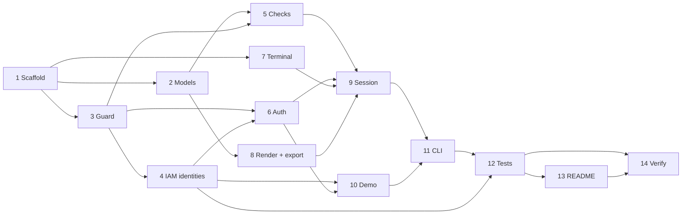

# Implementation Plan

## Overview

Build `cloudguard`, a read-only, MFA-protected AWS audit CLI, in Python. The work is split into 14 tasks:
- Scaffold and data model come first.
- Then the security foundations: the guard and the two IAM identities.
- Then the checks, authentication, terminal, rendering, and session.
- Last come the demo, CLI wiring, tests, README, and verification.

All tasks are complete.

## How the code is written (applies to every task)

This project is a teaching example. A reader should be able to open any file and understand what it does and why, without outside help. Every file follows the same comment style:

1. **File header**: a short block at the top answering *What is this file?*, *Why does it exist?*, and *Which requirements does it cover?* (e.g. `Req 8.6`).
2. **Section banners**: files are split into labeled sections:
   ```python
   # ============================================================
   # SECTION 2: The allow-list
   # ------------------------------------------------------------
   # Plain-English explanation of what this section does.
   # ============================================================
   ```
3. **Block comments**: short comments before each meaningful block, explaining *why*, not just *what*.
4. **Plain language**: short sentences, no jargon without a one-line explanation. A security or AWS term gets explained the first time it shows up in a file (e.g. "STS = AWS Security Token Service, it hands out temporary keys").
5. **"Security note" tags**: every line that exists for a security reason is marked `# SECURITY:` so a reviewer can `grep` all security decisions at once.

## Tasks

- [x] 1. Project scaffold
  - Create `cloudguard/` with `pyproject.toml` (pinned versions: boto3 1.43.110, rich 15.0.0; dev/demo: moto 5.2.3, pytest 9.1.1), package layout `src/cloudguard/`, and `tests/`.
  - Isolated dev sandbox via `dev.sh` (`setup`, `test`, `demo`, `run`, `clean`); all tool output in `$TMPDIR/cloudguard-sandbox`.
  - _Requirements: 10.1_

- [x] 2. Data model (`models.py`)
  - `Severity`, `Status`, `Finding`, `Report` with `counts()` and `sorted_findings()`.
  - _Requirements: 6.1, 6.2, 7.4_

- [x] 3. Client-side read-only guard (`guard.py`)
  - `AUDIT_OPERATIONS`, `BASE_OPERATIONS`, `iam_actions()` map, `BlockedOperationError`, `install_guard()` using botocore `before-call`.
  - _Requirements: 1.6, 8.6_

- [x] 4. IAM identity artifacts
  - [x] 4.1 Audit role
    - `infra/cloudguard-role.yaml`: 15-action allow-list, explicit `Deny` + `NotAction`, MFA trust policy (`MultiFactorAuthPresent` + `MultiFactorAuthAge < 900`), `MaxSessionDuration: 3600`.
    - Standalone `iam-policy.json` and `iam-trust-policy.json`.
    - _Requirements: 8.1, 8.2, 8.3, 8.4, 8.5, 8.8_
  - [x] 4.2 Operator user
    - `infra/cloudguard-operator.yaml`: user `cloudguard-operator`, no `LoginProfile`, Allow `sts:AssumeRole` on the Audit Role ARN only (built with `!Sub`), explicit `Deny` + `NotAction: sts:AssumeRole`, no MFA condition (enforced by the trust policy), `OperatorArn` output.
    - Standalone `iam-operator-policy.json`.
    - _Requirements: 1.6, 14.1, 14.2, 14.3, 14.4, 14.5, 14.6_

- [x] 5. Security checks (`checks/`)
  - [x] 5.1 IAM checks IAM-01..05 (credential report helper with polling)
    - _Requirements: 2.1, 2.2, 2.3, 2.4, 2.5_
  - [x] 5.2 S3 checks S3-01..03 (`GetBucketPolicyStatus` with `GetBucketPolicy` fallback)
    - _Requirements: 3.1, 3.2, 3.3, 3.4_
  - [x] 5.3 Network checks NET-01..02 (port-range and `-1` protocol matching)
    - _Requirements: 4.1, 4.2, 4.3_
  - [x] 5.4 Logging checks LOG-01..02 (`logging_checks.py`)
    - _Requirements: 5.1, 5.2, 5.3_
  - [x] 5.5 Registry `ALL_CHECKS` and `runner.py` that converts exceptions to ERROR findings
    - _Requirements: 6.3_

- [x] 6. Authentication (`auth.py`)
  - `AuthConfig`, `AuditSession`, `AuthFailed`, `AuthConfigError`.
  - `AwsAuthenticator`: preflight, `AssumeRole` with MFA and `DurationSeconds=900`, memory-only session, guard, identity verification, generic errors.
  - `DemoAuthenticator`: random demo code, `hmac.compare_digest`, same flow against moto.
  - _Requirements: 1.1, 1.2, 1.3, 1.4, 1.5, 8.7, 9.3, 11.1, 11.2, 11.3, 11.4_

- [x] 7. Terminal helpers (`terminal.py`)
  - `wipe`, `read_hidden` (getpass), `read_line` with `select` timeout on raw fd 0 (own buffer), `flush_input`, no `readline` import.
  - _Requirements: 11.1, 12.2, 13.1_

- [x] 8. Rendering and export (`render.py`, `export.py`)
  - rich summary table, detail view, markdown, json, `DEMO DATA` banner; 0600 exclusive-create export (`O_NOFOLLOW`) with confirmation.
  - _Requirements: 7.1, 7.2, 7.3, 7.4, 7.5, 9.4_

- [x] 9. Secure session (`session.py`)
  - State machine Locked ⇄ Unlocked, 3-attempt limit, idle 600s and STS-expiry lock, countdown prompt, commands, signal handlers, `atexit` wipe, core dumps disabled, `umask 077`.
  - _Requirements: 11.5, 11.6, 12.1, 12.2, 12.3, 12.4, 12.5, 13.1, 13.2, 13.3, 13.4_

- [x] 10. Demo environment (`demo.py`)
  - Fake creds in env, real `~/.aws` hidden, `mock_aws`, seed misconfigs + role, return config.
  - _Requirements: 9.1, 9.2_

- [x] 11. CLI entry point (`cli.py`, `__main__.py`)
  - argparse (`--profile`, `--region`, `--role-arn`, `--mfa-serial`, `--demo`), env var fallback, exit codes.
  - _Requirements: 1.2, 1.3, 1.4, 1.5, 13.5_

- [x] 12. Tests (56 passing)
  - Checks PASS/FAIL per category, guard blocks writes, policy parity across `guard.py` / `iam-policy.json` / CloudFormation, session idle/expiry lock, 3 failures exit 3, export 0600.
  - Operator policy test: only `sts:AssumeRole` on the Audit Role, explicit `NotAction` deny, no `LoginProfile`, MFA present in the trust policy.
  - _Requirements: 10.1, 10.2, 14.7_

- [x] 13. README
  - Problem, Mermaid flow diagram (laptop ⇄ AWS, numbered steps 1–9, the 3 read-only layers), session state diagram, usage, "How to read this code", security decisions, threat model, cost $0.
  - Least-privilege real-account guide: identity table, deploy operator → role, virtual MFA setup (QR kept in sandbox and deleted), access key saved without printing, `AccessDenied` proof, run as operator, teardown.
  - _Requirements: 10.3, 14.8_

- [x] 14. Verify
  - Full test suite, `cfn-lint` on both templates, pseudo-terminal smoke tests (demo flow, idle lock, SIGHUP, Ctrl+C, setup-error exit codes).
  - _Requirements: 10.1, 10.2_

## Task Dependency Graph

Tasks in the same wave don't depend on each other.

```json
{
  "waves": [
    {
      "wave": 1,
      "tasks": [
        "1"
      ]
    },
    {
      "wave": 2,
      "tasks": [
        "2",
        "3",
        "7"
      ]
    },
    {
      "wave": 3,
      "tasks": [
        "4",
        "5",
        "8"
      ]
    },
    {
      "wave": 4,
      "tasks": [
        "6"
      ]
    },
    {
      "wave": 5,
      "tasks": [
        "9",
        "10"
      ]
    },
    {
      "wave": 6,
      "tasks": [
        "11"
      ]
    },
    {
      "wave": 7,
      "tasks": [
        "12"
      ]
    },
    {
      "wave": 8,
      "tasks": [
        "13"
      ]
    },
    {
      "wave": 9,
      "tasks": [
        "14"
      ]
    }
  ]
}
```



## Notes

- Testing against a real AWS account is a manual step, outside this coding plan. Follow README steps 1–7: deploy the operator user and the audit role, set up MFA, run cloudguard as the operator, then tear everything down. This hasn't been done yet.
- The tests run fully offline with moto. `sh dev.sh test` runs them in the isolated sandbox.
- To add a new check:
  1. Add its API call to `guard.py`, `iam-policy.json`, and both statements in `infra/cloudguard-role.yaml`.
  2. The policy parity tests fail if any of these three don't match.
