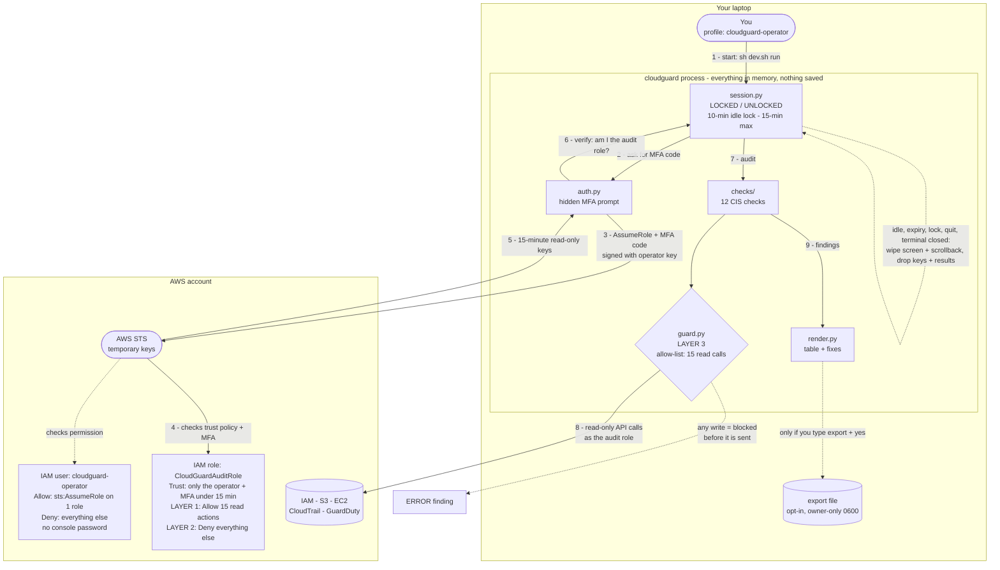
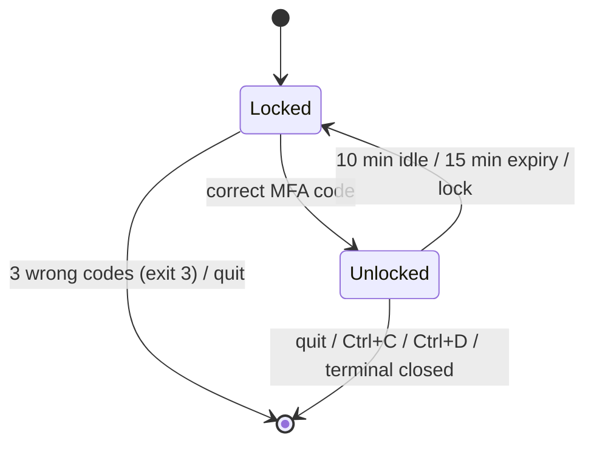

# cloudguard

A read-only, MFA-protected security audit tool for AWS. It checks an account for 12 common misconfigurations, maps each one to the CIS AWS Foundations Benchmark, and shows how to fix it. It costs $0 to run and can't change anything in your account.

Built as a portfolio project to show CompTIA Security+ and AWS Solutions Architect Associate skills applied to a real tool.

## The problem

Most cloud breaches don't come from clever exploits. They come from simple mistakes: a public S3 bucket, SSH open to the internet, a root account without MFA, logging switched off. cloudguard finds those mistakes in seconds.

A security tool that holds account access also has to be secure itself, so cloudguard is built around four rules:

1. **It can't change anything.** It's read-only, enforced in 3 separate layers.
2. **It shows nothing until you prove who you are.** MFA is required every time.
3. **It locks itself.** After 10 minutes idle (or 15 minutes total), it wipes the screen and forgets everything.
4. **It leaves no trace.** No command history, no saved credentials, no logs.

## Quick start (demo, free, no AWS account needed)

```sh
sh dev.sh setup   # one time: creates an isolated sandbox, installs pinned deps
sh dev.sh demo    # runs against a fake AWS account with planted problems
```

At the `MFA code:` prompt, type the demo code shown on screen. Then try:

```
audit              # run all checks
show CRITICAL      # details and fixes for the worst problems
show NET-01        # one specific check
lock               # lock now
quit               # wipe screen and exit
```

`sh dev.sh test` runs the 63 tests. `sh dev.sh clean` deletes the sandbox.

## How it works



Login flow in plain words:

1. Your normal AWS login is used for **one thing only**: asking AWS for the audit role.
2. You type a 6-digit MFA code. It's hidden, and it's never accepted as a command-line argument.
3. AWS checks the code and hands back temporary keys that expire in 15 minutes.
4. cloudguard confirms it's really running as the audit role. If not, it refuses to start.
5. Every check runs through the guard, which only allows read calls.

### Session states



Every move to **Locked** or to exit clears the screen and scrollback, and drops the keys and results from memory.

## What it checks

| ID | Check | Severity | CIS v3.0.0 |
|---|---|---|---|
| IAM-01 | Root account has MFA | CRITICAL | 1.5 |
| IAM-02 | Root account has no access keys | CRITICAL | 1.4 |
| IAM-03 | Console users have MFA | HIGH | 1.10 |
| IAM-04 | Access keys rotated within 90 days | MEDIUM | 1.14 |
| IAM-05 | Password policy requires 14+ characters | MEDIUM | 1.8 |
| S3-01 | Account-level Block Public Access is on | HIGH | 2.1.4 |
| S3-02 | Bucket-level Block Public Access is on | HIGH | 2.1.4 |
| S3-03 | Bucket is not public | CRITICAL | 2.1.4 |
| NET-01 | No SSH (22) open to the internet | HIGH | 5.2 / 5.3 |
| NET-02 | No RDP (3389) open to the internet | HIGH | 5.2 / 5.3 |
| LOG-01 | A multi-region CloudTrail trail is logging | HIGH | 3.1 |
| LOG-02 | GuardDuty is enabled | MEDIUM | AWS FSBP GuardDuty.1 |

## How to read this code

Every file starts with a header that answers *what is this?*, *why does it exist?*, and *which requirements does it cover?*. Files are split into numbered `SECTION` banners. Every line that exists for a security reason is tagged `# SECURITY:`. To list them all:

```sh
grep -rn "SECURITY" src/ infra/
```

Suggested reading order (each one builds on the last):

| # | File | What you'll learn |
|---|---|---|
| 1 | `src/cloudguard/models.py` | The data: Finding, Report, Severity |
| 2 | `src/cloudguard/checks/network.py` | A simple check, start to finish |
| 3 | `src/cloudguard/checks/iam.py`, `s3.py`, `logging_checks.py` | The other checks |
| 4 | `src/cloudguard/guard.py` | How code-level read-only works |
| 5 | `infra/cloudguard-role.yaml` | How AWS-level read-only and MFA work |
| 6 | `src/cloudguard/auth.py` | MFA → temporary keys → identity check |
| 7 | `src/cloudguard/session.py` | Locking, timeouts, wiping |
| 8 | `src/cloudguard/terminal.py` | Hidden input, timed input, screen wipe |
| 9 | `src/cloudguard/cli.py` | How everything is wired together |
| 10 | `tests/test_guard.py` | Proof that writes are blocked |

The full spec (requirements, design, tasks) is in `.kiro/specs/aws-security-audit-cli/`.

## Security decisions

**Read-only in 3 layers.** Any one layer alone is enough to block a write.

| Layer | Where | How |
|---|---|---|
| 1. Allow | IAM policy | The role is allowed exactly 15 read actions. No wildcards, and no broad managed policies like `SecurityAudit`. |
| 2. Deny | IAM policy | `Deny` + `NotAction` on everything else. In IAM an explicit Deny always wins, so even if someone attaches `AdministratorAccess` later, writes stay denied. |
| 3. Guard | Python code | A botocore `before-call` hook blocks any call not on the list *before it's sent*. This protects you even if the tool is run with the wrong (admin) credentials. |

A test (`tests/test_guard.py`) fails if the allow-list in `guard.py`, `iam-policy.json`, and the CloudFormation template ever drift apart.

**Authentication.**
- The role's trust policy requires `aws:MultiFactorAuthPresent = true` and an MFA code less than 15 minutes old. It trusts one specific user or role ARN, not the whole account.
- Your base credentials are guarded so they can only call `AssumeRole` and `GetCallerIdentity`. They're loaded first and then copied into a separate guarded session, so SSO and web-identity profiles can still fetch their own credentials. Every call cloudguard itself makes still goes through the guard.
- After login, the session identity must match `assumed-role/CloudGuardAuditRole/cloudguard-*`.
- Errors are always the generic "Authentication failed", so an attacker learns nothing about which part was wrong.
- After 3 wrong codes, the tool exits. Expired or missing base credentials are reported as a setup error (exit 2), not counted as a wrong code.

**Short-lived access.**
- STS sessions are 900 seconds (15 minutes), the shortest AWS allows.
- The role's `MaxSessionDuration` is 3600 seconds (1 hour), also the AWS minimum.
- The 10-minute idle lock is enforced by the app, because STS can't issue sessions shorter than 15 minutes.

**No trace left behind.**
- `readline` is never imported, so there's no command history.
- Keys are kept in memory only, never in `~/.aws` or environment variables.
- SDK logging is silenced, core dumps are disabled, and `umask 077` is set.
- Exports are opt-in and confirmed. They're created as `0600` from the first byte, symlinks are refused, and existing files are never silently overwritten.
- The launch command contains no secrets, so your shell history is safe.

## Threat model and limitations

| Threat | Mitigation | What's left (honest limits) |
|---|---|---|
| Bug or malicious code tries a write | IAM allow + explicit deny + client guard | None in AWS: IAM blocks it regardless of the code |
| Stolen base credentials | Role needs a fresh MFA code; base creds can only call AssumeRole | Attacker who has the base creds *and* your MFA device |
| Someone at your unlocked laptop | 10-min idle lock + screen and scrollback wipe | Terminals that ignore `ESC[3J`; tmux/screen buffers; terminal session logging |
| Data left on disk | Memory-only keys, no history, no logs, no core dumps | OS swap or hibernation files. Python can't securely zero memory, so cloudguard drops references and runs the garbage collector |
| Long-lived access | 15-min keys, role max 1 hour | Nothing beyond 15 minutes |
| Hostile resource names (e.g. a security group named `[/]`) | Every value from AWS or the user is escaped before rendering, so it can't crash the tool or restyle/hide findings | None known |

## How it was built

I built cloudguard in two phases, using AI coding tools the way I'd use them on a team: as a fast first draft, and then as a reviewer that has to prove every bug it reports.

**Phase 1: spec-driven build in Kiro IDE.** I wrote the project as a spec first: requirements, design, and a task list (in `.kiro/specs/aws-security-audit-cli/`). Then I built it in [Kiro](https://kiro.dev) using its **Auto** model setting to keep token costs low. Every security decision traces back to a numbered requirement, and code comments cite them (e.g. `Req 11.4`).

**Phase 2: review, bug fixing, and hardening with Claude Code (Opus 5.5).** I used Claude Code to audit the whole codebase, reproduce each suspected bug with a script before changing anything, and fix the bugs with regression tests. Every new test fails on the old code and passes on the fixed code. The 5 bugs fixed:

| Bug | Impact | Fix |
|---|---|---|
| Text with `[` `]` (typed by the user, or a security group name from AWS) was read as `rich` style markup | Typing `[/]` crashed the tool. A crafted security group name could crash `audit` or restyle the report | Escape every untrusted value before rendering |
| `export` onto a directory or symlink crashed on the "overwrite?" retry | The whole session ended with "Unexpected error" | Error handling now covers the retry too |
| The exit-time screen wipe always ran | Setup errors such as "No AWS credentials found" were erased the moment they appeared | Wipe on exit only if account data was shown |
| The read-only guard was installed before credentials were resolved | AWS SSO and web-identity profiles couldn't log in (the guard blocked `sso:GetRoleCredentials`) | Resolve credentials on a separate loader session, then make every API call through a guarded copy |
| Ctrl+C before login | Printed a Python traceback, which the design forbids | Handled as a clean exit |

Test suite: 56 → 63 tests, all passing.

**Known gaps (next steps):**
- S3-03 only looks at bucket policies, not ACLs.
- `ListBuckets` isn't paginated (needed for accounts with a raised bucket quota).
- LOG-01 reports ERROR if any single trail's status call fails, even when another trail is logging.
- Role ARNs are assumed to be in the `aws` partition (not GovCloud or China).
- Export paths can't contain spaces.

## Using it with a real AWS account (least privilege)

Running cloudguard needs only **two identities**, each with the smallest permissions that still work:

| Identity | Who uses it | Permissions | Can it read your account? | Can it change anything? |
|---|---|---|---|---|
| `cloudguard-operator` (IAM user, no console password) | You, running the tool | **1**: `sts:AssumeRole` on `CloudGuardAuditRole` only. Everything else is explicitly denied. The role's trust policy is what demands the MFA code. | No | No |
| `CloudGuardAuditRole` (IAM role) | cloudguard, for 15 minutes after MFA | **15** read actions. Everything else is explicitly denied. | Only the 15 settings the checks need | No |

An admin is needed **once** to create these two identities (steps 1 to 4), and once more to delete them (step 7). The admin is never used to run cloudguard. Everything below is free.

**1. Create the operator user.** Run this as your admin profile.

```sh
export AWS_PROFILE=<your-admin-profile>
ACCOUNT_ID=$(aws sts get-caller-identity --query Account --output text)

aws cloudformation deploy --template-file infra/cloudguard-operator.yaml \
  --stack-name cloudguard-operator --capabilities CAPABILITY_NAMED_IAM

OPERATOR_ARN=$(aws cloudformation describe-stacks --stack-name cloudguard-operator \
  --query "Stacks[0].Outputs[?OutputKey=='OperatorArn'].OutputValue" --output text)
```

**2. Create the audit role.** It trusts only the operator user. The order matters: AWS rejects a trust policy that points at a user who doesn't exist yet.

```sh
aws cloudformation deploy --template-file infra/cloudguard-role.yaml \
  --stack-name cloudguard-audit-role --capabilities CAPABILITY_NAMED_IAM \
  --parameter-overrides TrustedPrincipalArn="$OPERATOR_ARN"
```

**3. Give the operator a virtual MFA device.**
- The QR code contains the MFA secret, so it's written to the sandbox and deleted right after you scan it.
- The two 6-digit codes are one-time setup codes that expire within seconds.

```sh
QR="${TMPDIR%/}/cloudguard-sandbox/mfa-qr.png"
MFA_ARN=$(aws iam create-virtual-mfa-device --virtual-mfa-device-name cloudguard-operator \
  --outfile "$QR" --bootstrap-method QRCodePNG \
  --query VirtualMFADevice.SerialNumber --output text)
open "$QR"    # scan it with your authenticator app

aws iam enable-mfa-device --user-name cloudguard-operator --serial-number "$MFA_ARN" \
  --authentication-code1 <CODE_1> --authentication-code2 <NEXT_CODE_2>
rm -f "$QR"
```

**4. Create the operator's access key and save it to a profile.** The secret goes straight into the AWS CLI config and is never printed on screen.

```sh
read -r KEY_ID KEY_SECRET <<< "$(aws iam create-access-key --user-name cloudguard-operator \
  --query 'AccessKey.[AccessKeyId,SecretAccessKey]' --output text)"
aws configure set aws_access_key_id "$KEY_ID" --profile cloudguard-operator
aws configure set aws_secret_access_key "$KEY_SECRET" --profile cloudguard-operator
aws configure set region us-east-1 --profile cloudguard-operator
unset KEY_ID KEY_SECRET AWS_PROFILE
```

**5. Optional: prove the least privilege.** This makes a good demo moment. The operator can't even list buckets:

```sh
aws s3 ls --profile cloudguard-operator     # -> AccessDenied
```

**6. Run cloudguard as the operator.**

```sh
export CLOUDGUARD_ROLE_ARN="arn:aws:iam::$ACCOUNT_ID:role/CloudGuardAuditRole"
export CLOUDGUARD_MFA_SERIAL="$MFA_ARN"
sh dev.sh run --profile cloudguard-operator
```

**7. Tear it all down when you're done** (as admin).
- Delete the role stack first, so it never trusts a user that no longer exists.
- The user's access key and MFA device must be removed before CloudFormation can delete the user.

```sh
export AWS_PROFILE=<your-admin-profile>
aws cloudformation delete-stack --stack-name cloudguard-audit-role
aws cloudformation wait stack-delete-complete --stack-name cloudguard-audit-role

for KEY in $(aws iam list-access-keys --user-name cloudguard-operator \
  --query 'AccessKeyMetadata[].AccessKeyId' --output text); do
  aws iam delete-access-key --user-name cloudguard-operator --access-key-id "$KEY"
done
aws iam deactivate-mfa-device --user-name cloudguard-operator --serial-number "$MFA_ARN"
aws iam delete-virtual-mfa-device --serial-number "$MFA_ARN"
aws cloudformation delete-stack --stack-name cloudguard-operator
```

Finally, remove the `[cloudguard-operator]` section from `~/.aws/credentials` and `~/.aws/config`.

To create the identities by hand instead of with CloudFormation, use `iam-operator-policy.json`, `iam-policy.json`, and `iam-trust-policy.json`.

**Exit codes:**

| Code | Meaning |
|---|---|
| 0 | Normal exit |
| 1 | Unexpected error |
| 2 | Setup problem |
| 3 | Too many failed logins |

## Cost: $0

- IAM roles, policies, STS calls, and CloudFormation stacks for IAM resources have no charge.
- Every check is a Get, List, or Describe call, and those have no charge.
- cloudguard only *reads* CloudTrail and GuardDuty settings. It never turns them on, so it never starts billing.
- Demo mode makes zero AWS calls.

## Development sandbox

`dev.sh` keeps every generated file in one folder, `$TMPDIR/cloudguard-sandbox/`, which holds the virtualenv, pip cache, and Python bytecode. Nothing is installed globally, and the project folder stays clean. Set `CLOUDGUARD_SANDBOX=/path` to use a different location.

**Stack:** Python 3.11+, boto3 1.43.110, rich 15.0.0, moto 5.2.3, pytest 9.1.1. All versions are pinned exactly.
